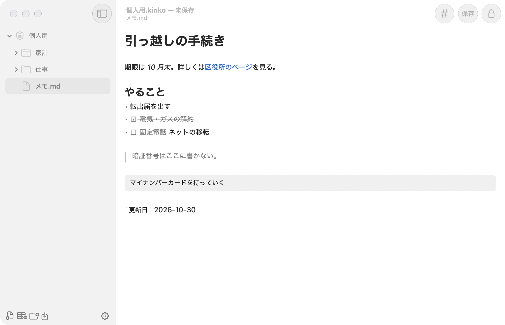
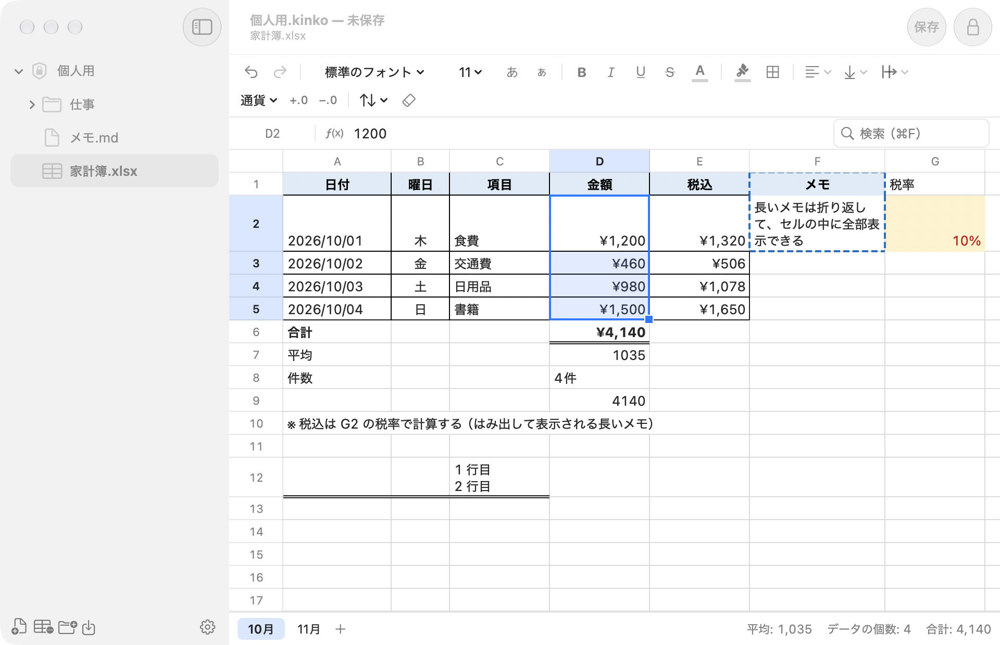
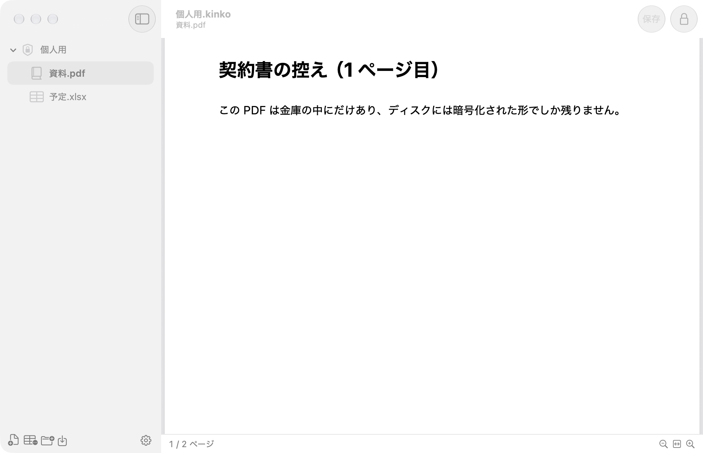
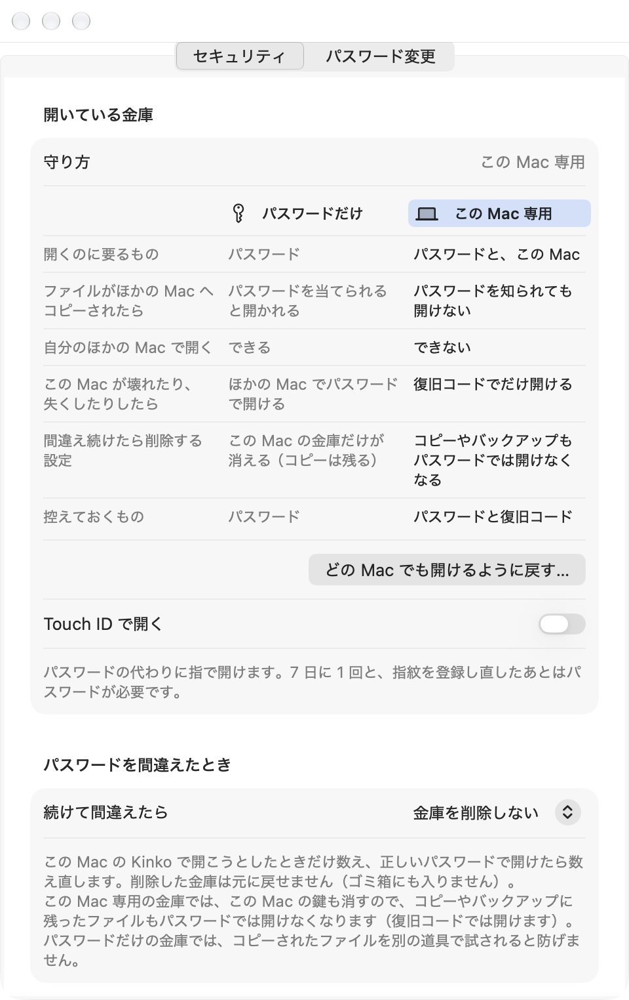

# Kinko

macOS 用の Markdown・表・PDF 対応暗号化メモアプリ。

メモ、表、PDF を 1 つの「金庫」（`.kinko` ファイル）にまとめて、暗号化して保存します。
ディスクに書くのはいつも暗号化した中身だけで、読める形の中身はアプリを開いている間のメモリの上にだけあります。



## できること

### Markdown のメモ
見出しや太字を整えて見せたまま編集できます（Obsidian のライブプレビューのような形）。チェックリストはクリックで切り替えられます。

### 表
Excel のような表を作れます。数式（SUM・IF・VLOOKUP など）、書式、罫線、並べ替え、検索に対応し、.xlsx・CSV の読み込みと書き出しもできます。



### PDF
PDF を金庫に入れて、そのまま読めます。PDF も金庫の中で一緒に暗号化されます。



### 守り方
- **パスワード：** パスワードから鍵を作るのに Argon2id を使い、総当たりで当てられにくくしています。
- **この Mac 専用：** この Mac の Secure Enclave の鍵がないと開けない金庫にできます。ファイルをコピーされても、ほかの Mac ではパスワードを知られても開けません。Mac を失くしたときのために、復旧コードを控えておきます。
- **Touch ID：** パスワードの代わりに指紋で開けます。
- **間違えたときの削除：** パスワードを続けて間違えたら金庫を削除する設定にできます。



## インストール

1. [リリース](https://github.com/Tomopu/Kinko/releases/latest)から `Kinko-<版>.dmg` をダウンロードして開きます。
2. Kinko をアプリケーションフォルダへドラッグします。
3. 初めて開くときは、「開発元を確認できない」などと表示されて止められます（Apple の公証を受けていないため）。
   「システム設定 > プライバシーとセキュリティ」の下のほうにある「このまま開く」を押してください。次からはふつうに開けます。

macOS 14 以降で動きます。

### アップデート
Kinko のメニューの「アップデートを確認…」で、新しい版があるか確かめられます。新しい版があれば、DMG をダウンロードしてアプリを置き換えてください。
金庫のファイル、この Mac の鍵、設定はアプリの外にあるので、そのまま使えます。

## 気をつけること
- **パスワードと復旧コードを忘れると、中身は誰にも取り出せません。** 作った人にも取り出せません。
- 書き出したファイルや、読み込んだ元のファイルは暗号化されません。
- 暗号やセキュリティの設計を学ぶために作っているアプリです。守れるものと守れないものは、[開発メモ](docs/DEVELOPMENT.md#守れるもの守れないもの)にまとめています。

## 開発
ソースからのビルド、作り、ファイルの形式、設計の詳しい説明は [docs/DEVELOPMENT.md](docs/DEVELOPMENT.md) にあります。

```bash
swift test
./scripts/build-app.sh && open build/Kinko.app
```
